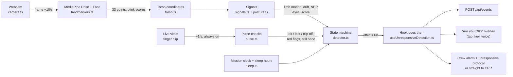

# Unresponsive crew member detection, explained

(Renamed from "collapse detection" on Nov 13: in microgravity nobody collapses.)

Owner: Jion (camera, UI), Jian (PPG fields), Yenna (numbers and protocol). Code: `frontend/src/cv/` and
`frontend/src/components/cv/`. Numbers: `backend/data/thresholds.json` → `"cv"`. Protocol:
`backend/data/protocols/unresponsive.json`.

## Setup (once per laptop, needs internet once)

```bash
cd frontend
npm install        # also copies MediaPipe's WebAssembly files to public/models/wasm (the "postinstall" script)
curl.exe -L -o public/models/pose_landmarker_lite.task https://storage.googleapis.com/mediapipe-models/pose_landmarker/pose_landmarker_lite/float16/latest/pose_landmarker_lite.task
curl.exe -L -o public/models/face_landmarker.task https://storage.googleapis.com/mediapipe-models/face_landmarker/face_landmarker/float16/latest/face_landmarker.task
```

After that everything runs with no internet. A missing model file shows a clear message in the camera panel. Commit
the two `.task` files (about 9 MB) so the demo laptop has them after `git clone`; `wasm/` is recreated by `npm install`.

---

## 1. The big picture

An unconscious astronaut in microgravity does not fall or slump: they float, their arms drift up into the "neutral
body posture", their hands stop doing anything, and their whole body may slowly drift or turn. So we never use "down"
in the camera picture. Every body point is measured relative to the person's own torso (origin between the shoulders,
in shoulder widths), which makes the numbers the same whatever the camera angle or the way the person is floating.
From that we score "no purposeful movement + floating posture + eyes closed + smooth drift" and, if it stays high for
25 s outside sleep hours (10 s with red vitals), ask "Are you OK? Tap, speak or move your hand." with a 15 s countdown.
Independently, the finger clip watches the pulse: a lost pulse with the clip on skips the question and goes straight
to the crew alarm and CPR, with or without the camera.



## 2. What an unconscious person looks like in microgravity

- **Neutral body posture (NBP).** With the muscles relaxed, the body settles by itself into a typical shape: arms float
  up in front to around chest or shoulder height with the elbows bent, shoulders raised, knees and hips bent, head
  tilted slightly forward. NASA described it from Skylab and Shuttle crews and put it in its design standards.
- **No purposeful movement.** The hands stop working: no typing, no reaching for handrails, no small corrections.
- **The body may still move.** Nothing holds it in place, so it can drift or rotate slowly and smoothly (air flow,
  the last push). Movement in the picture is therefore NOT a sign of being awake; movement of the hands relative to
  the body is.
- **Eyes closed, or open and not blinking.**
- **The catch:** a relaxed or sleeping astronaut takes the same posture. That is why NBP is only one part of the score,
  and is combined with the sleep schedule, the eyes, the lack of purposeful movement, the check-in and the pulse.

Sources (Yenna: please check section numbers before we quote them to judges):
- NASA-STD-3000, *Man-Systems Integration Standards*, Vol. I, anthropometry section: the neutral body posture figure.
- NASA-STD-3001, Vol. 2, *Human Factors, Habitability, and Environmental Health*: neutral body posture in design.
- Mount, F. E., Whitmore, M., Stealey, S. L., *Evaluation of Neutral Body Posture on Shuttle Mission STS-57
  (SPACEHAB-1)*, NASA TM-2003-104805 (2003): measured NBP on crew; it varies a lot between people, which is why we
  compare each person with their own calibrated working posture instead of one fixed shape.

## 3. Reading order

| # | File | What to look for |
|---|------|------------------|
| 1 | `src/cv/types.ts` | `Frame`, `Signals`, `PulseReading`, `DetectorState`, `Effect`, `CvThresholds`, with units in comments. |
| 2 | `src/cv/torso.ts` | `torsoFrame()` (origin, x along the shoulders, y toward the hips or away from the nose) and `toTorso()`. Everything else builds on this. |
| 3 | `src/cv/posture.ts` | The 4 NBP checks per arm, the calibration baseline, and how the score is "the step from your working posture toward NBP". |
| 4 | `src/cv/signals.ts` | `limbMotion` (two comparison gaps, fastest limb point), `bodyDrift` (straight-line fit), eye counters, the Moon-only fall block, `computeSignals`. |
| 5 | `src/cv/pulse.ts` | Clip off vs pulse lost vs still hand, from the live vitals. |
| 6 | `src/cv/*.test.ts` + `testFrames.ts` | Fake bodies built in torso coordinates and rotated 0/90/180 degrees; fake vitals. |
| 7 | `src/cv/detector.ts` | The state machine; the pulse-lost rule at the top of `update()`. |
| 8 | `src/cv/usePulseMonitor.ts`, `useUnresponsiveDetection.ts` | The only files with side effects: the always-on vitals watch, the camera loop, calibration and `perform()`. |
| 9 | `src/cv/voice.ts`, `camera.ts`, `landmarkers.ts` | Microphone loudness during the check-in, camera on/off, model loading. |
| 10 | `src/components/cv/*` | Header toggle and panel, the overlay, the debug panel, sliders and the skeleton drawing. |

## 4. The camera signals

Torso coordinates: origin between the shoulders, x along the shoulders, y toward the hips (or away from the nose if the
hips are out of view), unit = one shoulder width (sw). In these coordinates the head side is negative y.

| Signal | What it measures | Counts toward "unresponsive" when |
|---|---|---|
| `limbMotion` (sw/s) | Elbows and wrists moving relative to the torso (purposeful activity) | at or below `limb_motion_low` (0.05) |
| `bodyDrift` / `driftScore` | Torso moving in the picture: straight-line fit of position and rotation; wobble around the line | slow (0.02-0.6 sw/s) and smooth (wobble ≤ 0.05) |
| `nbpScore` (0-1) | Arms in the neutral body posture, compared with your calibrated working posture | close to 1 |
| `eyesClosedSeconds` | Both eyes closed without a break | full after `window_s` (5 s) |
| `secondsSinceBlink` (+ blinks/min) | Eyes open with no blink (a fixed stare) | full after `stare_after_s` (20 s); low weight |
| `stillHand` (from PPG) | Unusually clean pulse signal for 60 s: the hand with the clip is not moving | yes; low weight |
| `fallDetected` | Moon base only: hips drop fast in the picture, then stillness | jumps straight to SUSPECTED |

`unresponsiveScore = 0.3 limb stillness + 0.25 NBP + 0.25 eyes + 0.1 drift + 0.05 stare + 0.05 still hand` (weights in
the file). At or above `unresponsive_threshold` (0.7) the timer runs.

**Worked examples.**
- *Limb motion.* Shoulders 0.2 apart in the picture. Between two frames 0.5 s apart, the right wrist moved from torso
  point (0.40, 0.85) to (0.46, 0.80): distance 0.078 sw, per second 0.16 sw/s → typing, above 0.05, stillness =
  0.05 / 0.16 = 0.31. If instead the whole body drifted 0.05 picture units and turned 3 degrees, every torso point
  stays the same → 0 sw/s.
- *Drift.* The torso centre moves 0.1 sw/s in a straight line and turns 2 degrees/s (0.035 rad/s) for 5 s: speed
  0.135, wobble ~0 → driftScore ≈ 1. Someone pushing off: 0.8 sw/s → 0. Someone shifting back and forth: big wobble → 0.
- *NBP, one arm.* Shoulder (−0.5, 0), elbow (−0.92, 0.42), wrist (−1.27, 0.07) in torso coordinates.
  Elbow angle 90° → 1 (inside 60-120). Wrist 0.35 sw above the elbow → 1 (full at 0.2). Upper arm 45° from the torso
  line → 1 (full at 30°). Wrist in front of the elbow (depth) → 1. Arm score 1.0. Typing gives about 0.6 (elbow bent,
  wrist level, arm down). Calibrated while typing (0.6): NBP score = (1.0 − 0.6) / (1 − 0.6) = **1**; typing = **0**.
- *Score.* Floating unconscious: hands still (1 × 0.3) + NBP 1 (0.25) + eyes closed 6 s (1 × 0.25) + slow drift 0.8
  (0.08) + stare 0 + still hand 1 (0.05) = **0.93** → timer runs. Relaxed but awake, eyes open, floating arms:
  0.3 + 0.25 + 0 + 0.08 + 0.02 = **0.65** → below 0.7, no question asked. Typing: limbs 0.31 × 0.3 + 0 … ≈ **0.1**.

## 5. The pulse signals (finger clip; camera not needed)

| Case | How it is recognised | What happens |
|---|---|---|
| **Pulse lost** | Good contact (signal_quality ≥ 0.6, light baseline steady) AND pulse wave below 15 % of this person's normal for 5 s, OR no beats for 5 s, OR the `pulse_lost` red flag (HR below 38 for 3 s) | Straight to ALARM + CPR, no check-in, even in sleep hours |
| **Clip off** | signal_quality below 0.2, or the light baseline jumps by more than 50 % | Only "check the sensor"; never an alarm |
| **Still hand** | signal_quality ≥ 0.9 without a dip for 60 s | Supporting signal (5 % of the score) |
| **Red flags** | Any `red_flags` entry active (HR very low/high, SpO2 falling...) | Camera wait 25 s → 10 s |

The "normal" amplitude is learned only while the pulse is OK, so a long flat stretch never becomes the new normal.

**What Jian must add to his PPG output** (all optional `VitalsFrame` fields; his current frames keep working):

| Field | Meaning | Notes |
|---|---|---|
| `pulse_amplitude` | Height of the pulse wave (peak to trough of the AC part), averaged over the last ~1-2 s | Any unit, but the same every frame; we compare with the person's own normal |
| `beats_detected` | Number of heartbeats found in this frame's second (0, 1, 2…) | 0 for several seconds with good contact = no pulse |
| `ppg_baseline` | The steady light level (DC part / mean raw value), scaled 0-1 if possible | Jumps when the clip comes off; steady with a flat pulse |
| `signal_quality` (existing) | Must describe **contact and motion noise**, not "is there a pulse" | A flat pulse with the clip on must still be good quality, otherwise "pulse lost" reads as "clip off" |

## 6. The state machine

| State | Condition | Next state | Effects |
|---|---|---|---|
| any except ALARM | pulse lost (not already in emergency mode) | ALARM | post `alarm`, hide overlay, crew alarm, open protocol **straight to CPR** (`goto=cpr`) |
| MONITORING | camera off, sleep hours, paused screen (daily check, emergency) or nobody present | MONITORING (timer reset) | none |
| MONITORING | fall detected (Moon base only) | SUSPECTED | post `unresponsive_suspected` |
| MONITORING | score < 0.7 | MONITORING (timer reset) | none |
| MONITORING | score ≥ 0.7 for 25 s (10 s with red vitals) | SUSPECTED | post `unresponsive_suspected` |
| SUSPECTED | next update | CHECK_IN | post `checkin_started`, show "Are you OK? Tap, speak or move your hand." (15 s) |
| CHECK_IN | tap, key, voice or "I'm OK" | COOLDOWN | post `ok_confirmed`, hide overlay |
| CHECK_IN | limb motion ≥ 0.4 sw/s (a purposeful hand movement; body drift does not count) | COOLDOWN | same |
| CHECK_IN | 15 s, no answer | ALARM | post `alarm`, crew alarm, open `/emergency?protocol=unresponsive&trigger=cv&preanswer=responsive:no` |
| COOLDOWN / ALARM | 120 s passed | MONITORING | post `monitoring_resumed` |

The protocol (DRAFT, Yenna reviews) follows the microgravity order: 1 respond? (answered NO) → 2 stop the drift (hold
the torso, guide to a wall) → 3 restrain against a firm surface → 4 airway and breathing → 5 pulse → CPR if needed →
6 oxygen → 7 watch → 8 stay and message the surgeon. A lost pulse jumps straight to the CPR guide, which itself starts
with "restrain the patient". While CPR is open, no other red flag may move the crew away from it.

## 7. Why it is built this way

- **Body-relative coordinates.** In microgravity "down" in the picture is meaningless and the crew member can be at any
  angle. Measuring relative to the torso makes the signals identical at 0, 90 or 180 degrees (tested).
- **Hands relative to torso, not movement in the picture.** A floating unconscious body still moves; only purposeful
  limb movement shows someone is awake. Same rule for answering the check-in: drift never counts as an answer.
- **Calibration of the working posture.** NBP differs a lot between people (TM-2003-104805), and some work postures
  already look a bit like it. Scoring the change from your own posture avoids false alarms.
- **Several weak signals, not one strong one.** Sleeping and resting look like unconsciousness, so no single signal
  can decide; the sleep schedule, the eyes, the check-in and the pulse all have to agree.
- **Pulse first.** A lost pulse is the case where seconds matter, so it bypasses the camera, the sleep window and the
  check-in. A removed clip must never cause that, hence the separate clip-off rule.
- **Pure functions and an effects list.** All rules take numbers and return numbers (tested in milliseconds with fake
  bodies and clocks); only the hook touches the camera, the network and the screen.
- **Browser, on-device.** Frames never leave the page, no video is stored, it works with the backend off.
- **Falls only on the Moon.** 1/6 g still lets people fall; that one signal uses the picture's "down" (camera mounted
  upright) and is switched off everywhere else.

## 8. Questions a judge might ask

1. **"Isn't an unconscious astronaut just lying still?"** No: they float. Arms rise into the neutral body posture and
   the body may drift. We look for the hands doing nothing relative to the body, not for stillness in the picture.
2. **"A sleeping astronaut looks the same. How do you avoid false alarms?"** Sleep hours from the mission schedule
   switch the camera trigger off; outside them we need 25 s of a high combined score and then only ask. Any tap, word or
   hand movement cancels. The pulse decides the truly urgent case.
3. **"What if they float upside down in front of the camera?"** All measurements are relative to the torso, so the
   numbers do not change; we test it by rotating fake bodies 90 and 180 degrees.
4. **"What if the camera is off or they float out of view?"** The finger clip still watches the pulse; a lost pulse
   raises the alarm and opens CPR without the camera. A removed clip only asks to check the sensor.
5. **"Why stop the drift before CPR?"** You cannot do compressions on a floating body: it moves away. Restraining
   against a surface comes first, as in NASA microgravity CPR methods; our protocol and CPR guide follow that order (DRAFT).
6. **"Privacy?"** On-device, no video stored or sent, only numbers in the local log, camera at work modules only, off by default.

## 9. Tuning with the debug panel

Open `/admin` (type it), scroll to **Unresponsive detection (debug)**. Press **Turn the camera on** and work normally
for 5 s (calibration records your working posture).

- **Left column:** phase, state and why, timers, sleep / paused, and the PPG: pulse status and reason, quality,
  amplitude vs normal, seconds without beats, still hand, red vitals.
- **Right column:** limb motion, drift and smoothness, NBP score (with your working baseline), eyes closed, stare and
  blinks per minute, the combined score; amber when it points toward "unresponsive".
- **Torso view:** the skeleton redrawn in torso coordinates (it stays upright when you tilt your head or the laptop).
  Tick **Draw the skeleton on the camera preview** to see the points and the two torso axes on the video.
- **Sliders** (session only), **Copy as JSON**, **Back to file values**, **Demo trigger**.

Tune in this order:
1. **`limb_motion_low`**: hold your hands still and read "Limb motion". Camera jitter keeps it above 0; set the limit a
   little above your value. Then type: it must be clearly higher.
2. **NBP**: let your arms float up and relax (or mimic NBP); "Neutral body posture" should rise toward 1, and stay near
   0 while you work.
3. **`limb_motion_spike`**: during "Are you OK?", a small hand wave must cancel it; turning your whole body must not.
4. **Drift**: slowly slide or turn the laptop camera while keeping still: drift smoothness should rise, limb motion
   should not.
5. **PPG with Jian's sensor**: take the clip off (clip off, no alarm); press it firmly so the pulse flattens with good
   contact (should read "lost" after 5 s; do this only as a test).
6. Then 10 minutes of normal work for each of you with no check-in.

Put agreed numbers in `backend/data/thresholds.json` and run `python scripts/export_mocks.py` in `backend/`.

**Known limits:** a background browser tab slows the camera loop (the pulse check keeps running). The face must be in
view for "present"; a crew member who floats fully out of view only counts once the check-in is already showing. The
2D camera sees depth poorly, so the "wrist in front" NBP check has a quarter of the arm score at most. Blinks can be
missed at 10 frames a second, which is why staring has a low weight. Voice detection is loudness only (any word or
sound counts) and needs microphone permission; tapping always works.
